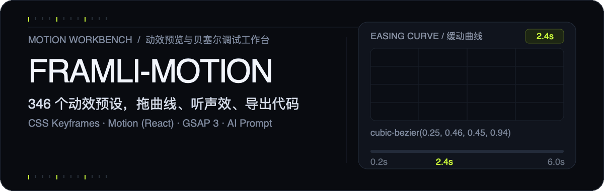
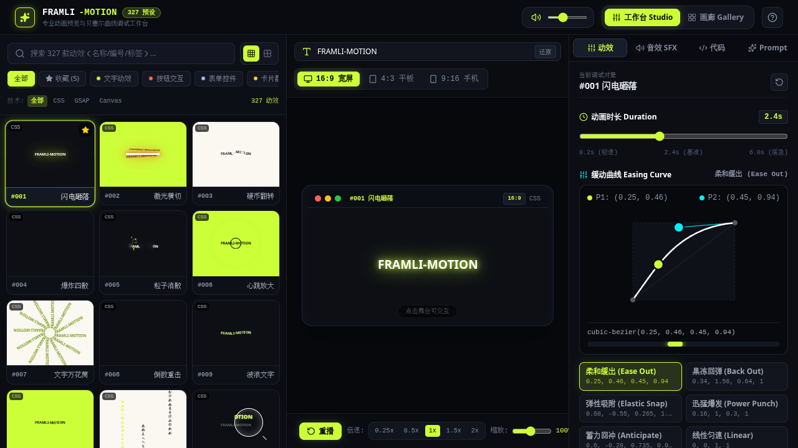
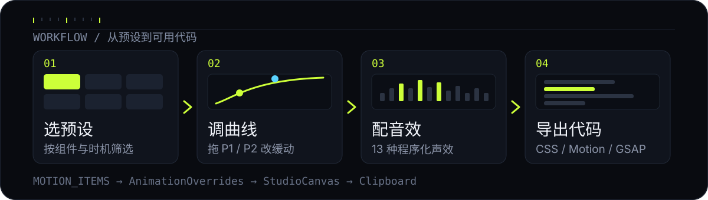

<p align="center">
  
</p>

<p align="center">
  <sub><a href="./assets/readme/hero.svg">静态 SVG 版本</a> · <a href="./assets/readme/hero-motion.json">动效参数</a> · 5 秒循环 / 0.94 MB</sub>
</p>

<p align="center">
  
</p>

<p align="center">
  <sub>预设库 → 实时舞台 → Inspector。截图拍于 327 预设版本，当前数据为 346 条。</sub>
</p>

**FRAMLI-MOTION 是一个跑在浏览器里的动效调试工作台。** 挑一个预设，拖贝塞尔控制点把节奏调准，配上程序化声效，然后把能直接用的代码复制走。不用装设计软件，也不用猜 `cubic-bezier()` 里那四个数字。

## 能做什么

- **346 条预设数据**（编号延伸至 #350），按 9 类组件、7 类触发时机以及 CSS / GSAP / Canvas 技术筛选；支持搜索、收藏与键盘切换。
- **可视化缓动编辑**：拖动 P1 / P2 控制点或套用预设曲线，调时长（0.2–6s）、交错、缩放、播放倍速与循环；舞台提供 16:9 / 4:3 / 9:16 三种比例和 4 套主题。
- **音画同步**：13 种 Web Audio 程序化声效原型，按动效类型自动匹配，只在重播或切换预设时响一次，不循环扰耳。
- **一次调参，四种产出**：CSS Keyframes、Motion (React)、GSAP 3 代码片段，以及可复制给 AI 的完整动效描述 Prompt。
- **自己的文本实时驱动**：输入文字、数字或标点，舞台立刻重绘。

## 工作流

<p align="center">
  
</p>

预设从 `src/motion-engine/motionData.ts` 读出为 `MOTION_ITEMS`，筛选后进入左侧预设库；`AnimationOverrides` 保存当前时长、缓动与交错参数，`StudioCanvas` 据此重绘舞台；`StudioInspector` 同时负责参数编辑、声效配置和三种代码 / Prompt 导出。全部状态留在前端，收藏与音效设置存 `localStorage`，其余调参刷新即重置。

## 快速开始

需要 Node.js 22+ 与 bun（或 npm）。

```bash
bun install
bun run dev          # http://localhost:3000
```

用 npm 时，依赖存在 peer 版本冲突，需要加参数：

```bash
npm install --legacy-peer-deps
npm run dev
```

本地开发不需要配置任何 API Key：`.env.example` 是模板遗留，当前代码没有读取环境变量。生产构建用 `npm run build`，类型检查用 `npm run lint`。

## 项目结构

```text
src/
├── components/      Header / HomePage / 预设库 / 舞台 / Inspector
├── motion-engine/   预设数据、动效函数、远程 FX 样式
├── audio/           Web Audio 程序化声效引擎
├── utils/           筛选与 CSS / Motion / GSAP / Prompt 生成器
└── types/           MotionItem、AnimationOverrides 等类型
scripts/             简繁术语标准化脚本（opencc-js）
assets/readme/       README 的 SVG / GIF 视觉素材与动效参数
```

## 快捷键

| 键 | 作用 |
| --- | --- |
| `R` | 重播当前动效，并触发一次声效 |
| `M` | 静音 / 取消静音 |
| `↑` / `↓` | 在筛选结果里切换上一条 / 下一条预设 |

## 现状与边界

- 预设是随仓库打包的静态数据，不是运行时远程拉取；`scripts/convert-and-refine.mjs` 负责简繁术语标准化。
- `index.html` 通过 jsdelivr 预载 GSAP 及插件脚本。标注为 GSAP 技术的预设在离线时会走内置降级渲染，表现可能与联网时不同。
- 声效由浏览器 Web Audio 合成，需要用户交互后才能出声；这是浏览器策略，不是故障。
- 仓库目前没有 `LICENSE` 文件。二次分发或商用前请先联系作者。

## 相关链接

- [X · @Gotoobig](https://x.com/Gotoobig)
- [GitHub · FRAMLI--Motion-Studio](https://github.com/pixox24/FRAMLI--Motion-Studio)

技术栈：React 19 · TypeScript · Vite 8 · Tailwind CSS 4 · Motion · GSAP（CDN）· lucide-react
